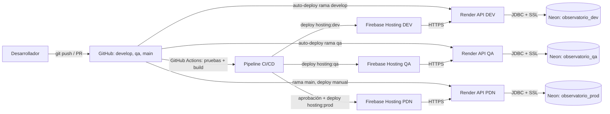

# Despliegue en la nube: Observatorio de Lluvias de Manizales

Taller práctico de la electiva Laboratorio DevOps. Modalidad A (aplicación base entregada por el docente).

**Plataforma principal:** Firebase Hosting (frontend) + Render (API) + Neon (PostgreSQL), con pipeline en GitHub Actions.

> Los datos de la aplicación son ficticios y de demostración. Este repositorio no contiene credenciales, tokens ni contraseñas.

## 1. Arquitectura



| Capa | Tecnología | Servicio de nube |
|---|---|---|
| Frontend | React + Vite | Firebase Hosting (3 sitios) |
| API | Java 17 + Spring Boot (Docker) | Render, 3 servicios web |
| Base de datos | PostgreSQL 16 | Neon, 3 bases en un mismo proyecto |
| CI/CD | GitHub Actions | GitHub |

## 2. URLs por ambiente

| Ambiente | URL de la aplicación | URL de la API | Estado |
|---|---|---|---|
| DEV | https://observatorio-dev-misifu.web.app | https://observatorio-api-dev.onrender.com | Validado |
| QA | https://observatorio-qa-misifu.web.app | https://observatorio-api-qa.onrender.com | Validado |
| PDN / Producción | https://observatorio-prod-misifu.web.app | https://observatorio-api-prod.onrender.com | Validado |

Las APIs gratuitas de Render se apagan tras 15 minutos sin tráfico. La primera petición puede tardar cerca de un minuto en responder.

## 3. Ramas y flujo de promoción

| Rama | Ambiente | Cómo se despliega |
|---|---|---|
| `develop` | DEV | Automático en cada push |
| `qa` | QA | Automático al hacer merge de `develop` a `qa` |
| `main` | PDN | Merge de `qa` a `main` + **aprobación manual** en GitHub |

Flujo de un cambio: commit en `develop` → pruebas y despliegue a DEV → Pull Request `develop → qa` → despliegue a QA → Pull Request `qa → main` → aprobación del revisor → despliegue a PDN.

## 4. Pipeline (`.github/workflows/deploy.yml`)

| Paso | Qué hace | Si falla |
|---|---|---|
| 1. Checkout | Descarga el código de la rama | Se detiene |
| 2. Dependencias | `npm ci` en el frontend | Se detiene |
| 3. Pruebas | `npm test` (si existe) y `mvn verify` en el backend | Se detiene |
| 4. Compilación | `npm run build` con la URL de API del ambiente | Se detiene |
| 5. Despliegue | `firebase deploy --only hosting:<target>` | Se detiene |
| 6. Prueba de humo | `curl` a `/actuator/health`, `/api/dashboard/summary` y a la URL del sitio | El job falla y queda registrado |
| 7. Registro | Resumen del job con commit, rama, resultado y URL | Se ejecuta siempre |

- Las **pruebas** corren también en cada Pull Request, pero el **despliegue** solo ocurre con un push.
- El ambiente `production` de GitHub exige un **revisor**. El job de PDN espera su aprobación antes de continuar.
- El despliegue de las APIs lo hace Render desde la misma rama (auto-deploy en `develop` y `qa`; manual en `main`).
- El `Jenkinsfile` de referencia que trae el proyecto no se usa en esta solución.

## 5. Configuración, variables y secretos

| Dato | Dónde vive | ¿Secreto? |
|---|---|---|
| `API_URL` y `SITE_URL` por ambiente | GitHub: Settings → Environments (`develop`, `qa`, `production`) → Variables | No |
| Cuenta de servicio de Firebase para el pipeline | GitHub: Secret `FIREBASE_SERVICE_ACCOUNT_OBSERVATORIO_LLUVIAS` | Sí |
| `SPRING_DATASOURCE_URL`, `USERNAME`, `PASSWORD` | Render: variables de entorno de cada API | Sí |
| `APP_CORS_ORIGINS` (solo el origen del frontend de ese ambiente) | Render: variables de entorno | No |
| `SERVER_PORT` | Render: variables de entorno | No |

Ningún secreto está en el repositorio. Solo se versiona `.env.example`, con valores de ejemplo.

## 6. Ejecución local

```bash
docker compose up --build
```
- Frontend: http://localhost:5173
- API: http://localhost:8080/api/dashboard/summary

## 7. Cómo revertir una versión

- **Frontend:** en la consola de Firebase, *Hosting → sitio → Release history → Rollback* a la versión anterior. También se puede hacer `git revert` del commit y push a la rama.
- **API:** en Render, abrir el servicio y volver a desplegar un deploy anterior, o hacer `git revert` y push a la rama.
- **Base de datos:** los datos son de demostración; no hay migraciones destructivas en el flujo.

## 8. Servicios, seguridad y costos

| Servicio | Uso | Seguridad aplicada | Costo potencial |
|---|---|---|---|
| Firebase Hosting (plan Spark) | 3 sitios del frontend | HTTPS automático, cuenta de servicio solo para el pipeline | Gratis dentro de las cuotas del plan; el plan Blaze se factura por uso |
| Render, plan Free | 3 APIs Spring Boot | HTTPS automático, secretos en variables de entorno, CORS limitado al sitio de cada ambiente | $0, con 512 MB de RAM y apagado por inactividad. Subir una API a Starter cuesta cerca de $7 al mes |
| Neon, plan Free | 3 bases PostgreSQL en un proyecto | Conexión con SSL y credenciales | $0 con 512 MB de almacenamiento compartido |
| GitHub Actions | Pipeline | Secretos cifrados, aprobación en `production` | Gratis en repositorios públicos |

Precios y límites consultados en octubre de 2026. Conviene revisar las páginas de precios de cada proveedor antes de usar los servicios más allá de este taller.

## 9. Limitaciones conocidas

- La aplicación no tiene autenticación; solo debe usarse con datos de demostración.
- Las tres bases de datos comparten un mismo proyecto en Neon (aislamiento lógico, no físico).
- La base de datos es accesible desde Internet con SSL y contraseña; restringir por IP no se aplica en el plan gratuito.
- Las APIs gratuitas se apagan por inactividad, y el primer acceso es lento.

## 10. Procedimiento de limpieza al finalizar

1. **Render:** abrir cada servicio (`dev`, `qa`, `prod`) → *Settings* → *Delete Web Service*.
2. **Neon:** *Project settings* → *Delete project* (elimina las tres bases).
3. **Firebase Hosting:** eliminar los sitios con `firebase hosting:sites:delete ID_DEL_SITIO` o borrar el proyecto completo en *Project settings → Delete project*.
4. **Google Cloud:** en *IAM → Service accounts*, borrar la cuenta de servicio creada para GitHub Actions.
5. **GitHub:** borrar los secretos y variables de los Environments, o eliminar el repositorio.
6. **Verificación:** confirmar que Render, Neon y Firebase no muestran recursos activos y que no hay cargos pendientes.

## 11. Datos del equipo

| Campo | Respuesta |
|---|---|
| Integrantes | [Eduard Stiven Jimenez - Nicolas Casas Bedoya - Stiven Rodas] |
| Modalidad | Aplicación base proporcionada por el docente |
| Plataforma principal | Firebase Hosting + Render (API) + Neon (BD) |
| Repositorio | [COMPLETAR: https://github.com/Misifu987654/Observatorio_Lluvias_Manizales] |
| URL DEV / QA / PDN | Ver sección 2 |
| API DEV / QA / PDN | Ver sección 2 |
| Base de datos y persistencia | PostgreSQL en Neon, una base por ambiente, sin credenciales en el repositorio |
| Pipeline | [https://github.com/Misifu987654/Observatorio_Lluvias_Manizales/actions] |
| Costos y limpieza | Secciones 8 y 10 |
